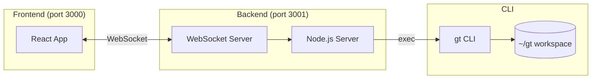
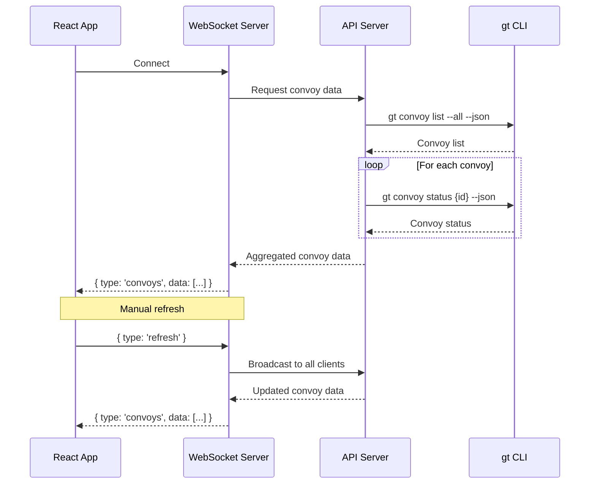

# Gas Town Convoys

A real-time dashboard for monitoring convoy operations from the `gt` CLI. Features an industrial/steampunk aesthetic with live WebSocket updates.

## Dashboard Stats

| Stat | Description |
|------|-------------|
| **Guzzoline** | Completion rate (completed items / total items across all convoys) |
| **Polecats** | Count of unique polecats (`*/polecats/*`) assigned to open convoy issues |
| **Crew** | Count of unique crew members (`*/crew/*`) assigned to open convoy issues |
| **Updated** | When convoy data last changed (relative time: today shows time, older shows "yesterday", "2d ago", etc.) |

## Quick Start

```bash
npm install
npm start        # Runs both API server (3001) and frontend (3000)
```

**Prerequisites:** Node.js and the `gt` CLI installed with a workspace at `~/gt`

## Architecture



## Data Flow



- **Frontend** receives convoy updates via WebSocket (no polling)
- **Server** wraps `gt convoy list` and `gt convoy status` commands
- Manual refresh available; server broadcasts to all clients on refresh

## Convoy Status Mapping

| gt CLI (`status`) | App (`ConvoyStatus`) | Condition |
|-------------------|----------------------|-----------|
| `closed` | `COMPLETE` | Convoy is closed |
| `open` | `RUNNING` | Has incomplete tracked items |
| `open` | `STALE` | No tracked items |
| `open` | `COMPLETE` | All tracked items complete |

## Commands

| Command | Description |
|---------|-------------|
| `npm start` | Run server + frontend together |
| `npm run server` | API server only (port 3001) |
| `npm run dev` | Vite dev server only (port 3000) |
| `npm run build` | Production build |
| `npm test` | Run tests |

## Configuration

| Env Variable | Default | Description |
|--------------|---------|-------------|
| `GT_WORKSPACE` | `~/gt` | Path to gt workspace |
| `API_PORT` | `3001` | API server port |

## API Endpoints

- `GET /api/convoys` - All convoy statuses
- `GET /api/convoy/:id` - Single convoy status
- `GET /api/convoy-list` - Convoy list (minimal data)
- `ws://localhost:3001` - WebSocket for real-time updates
